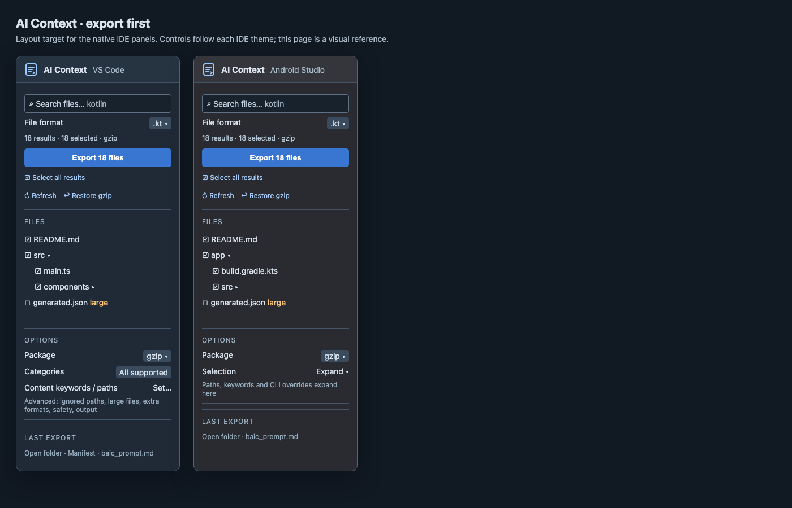

# Build AI Context (IntelliJ Platform)

Export the open project into AI-readable text bundles. No Python, Node, or extra JRE.

Works in IntelliJ IDEA, Android Studio, WebStorm, PyCharm, and other IntelliJ Platform IDEs.



The **AI Context** tool window is one export-first panel: search, file format, **Export N files**, a checkable file tree, Options, and Last export.

gzip (tar-gz) is the default. Export writes bundles, a manifest, and `baic_prompt.md`. Restore unpacks a previous gzip export. The plugin stays on your machine.

## Install

JetBrains Marketplace listing (after the first publish): plugin id `com.asjnaang.buildaicontext`.

Until that listing is live, package from this repository:

```bash
cd ide/intellij
./gradlew :plugin:buildPlugin
```

The zip is `ide/intellij/plugin/build/distributions/plugin-0.1.0.zip`.

In the IDE: **Settings → Plugins** → gear → **Install Plugin from Disk…** → select the zip → restart.

## Use

1. Open a project. The catalog loads in the background.
2. Open the **AI Context** tool window (right side).
3. **Search files** matches path, filename, or category. **File format** narrows by extension (`All formats` clears it).
4. Uncheck files you do not want, or use **Select all results**. Oversized files start unchecked and show `large`.
5. Click **Export N files**. Only checked files in the current results are exported.
6. **Restore gzip** unpacks a previous export. **Refresh** reloads the catalog.

**Options** holds package (gzip/text). **Selection Expand** holds categories, keywords, paths, ignored paths, large files, split gzip, and extra formats. **Last export** opens the folder and `baic_prompt.md`.

## Mapping to `baic`

This Host covers the same workflow as the `baic` CLI: catalog, search and file-format filtering, selection by category / path / content keyword, gzip or text transport, restore, redact, secret skip, oversized-file handling, filetree, code graph, and project overview.

Settings live under **Settings → Tools → Build AI Context**. For sample projects, disable gitignore updates and set the output directory outside the project tree.

## Privacy

The plugin does not upload your code. Scan and export run inside the IDE on the open project.
