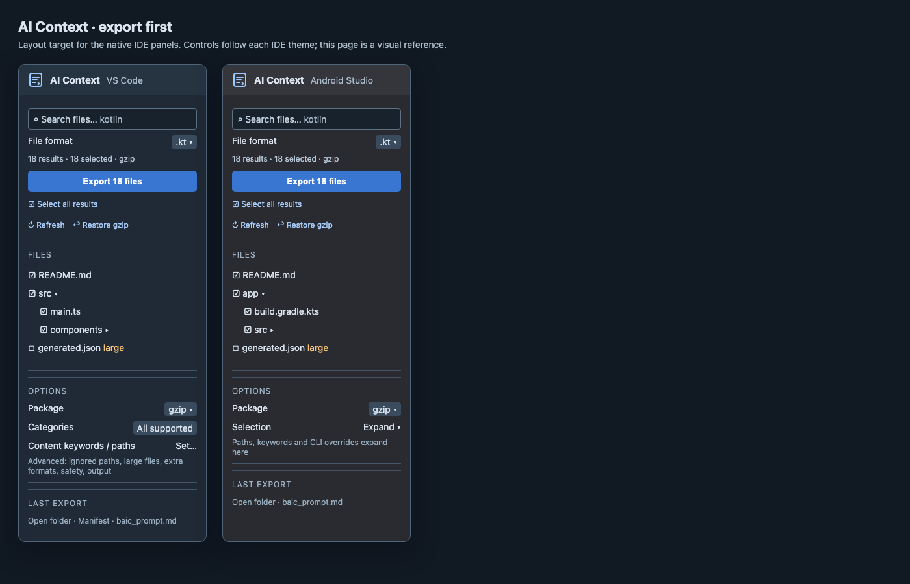

# Build AI Context

Export the open workspace into AI-readable text bundles. No Python install.



The **AI Context** view is one export-first panel: search, file format, **Export N files**, a checkable file tree, Options, and Last export.

gzip (tar-gz) is the default. Export writes bundles, a manifest, and `baic_prompt.md`. Restore unpacks a previous gzip export. The Host stays on your machine: it reads a trusted workspace and writes the folder you choose.

## Install

Marketplace listing (after the first publish): `asjnaang.build-ai-context`.

Until that listing is live, package from this repository:

```bash
npm --prefix ide/vscode run package
```

That writes `ide/vscode/build-ai-context-0.1.0.vsix`. In VS Code: Command Palette → **Extensions: Install from VSIX…** → select the VSIX → reload.

## Use

1. Open and trust a folder. The catalog loads in the background.
2. Open **AI Context** in the Activity Bar.
3. **Search files** matches path, filename, or category. **File format** narrows by extension (`All formats` clears it).
4. Uncheck files you do not want, or use **Select all results**. Oversized files start unchecked and show `large`.
5. Click **Export N files**. Only checked files in the current results are exported.
6. **Restore gzip** unpacks a previous export. **Refresh** reloads the catalog.

**Options** holds package (gzip/text), categories, content keywords, paths, and Advanced (ignored paths, large files, split gzip, extra formats). **Last export** opens the folder, manifest, and `baic_prompt.md`.

## Mapping to `baic`

This Host covers the same workflow as the `baic` CLI: catalog, search and file-format filtering, selection by category / path / content keyword, gzip or text transport, restore, redact, secret skip, oversized-file handling, filetree, code graph, and project overview.

Settings live under **Build AI Context** (`baic.*`). For sample projects, set `baic.updateGitignore` to `false` and `baic.outputDir` outside the project tree.

## Privacy

The extension does not upload your code. Scan and export run in the VS Code extension host on a trusted workspace.
